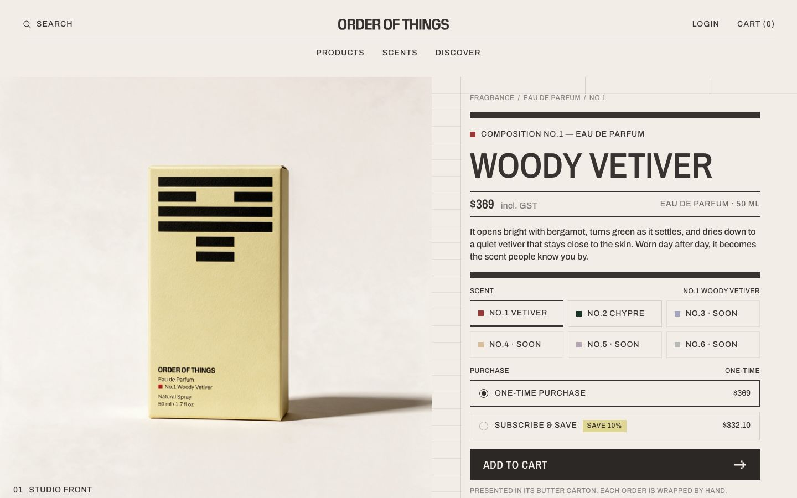
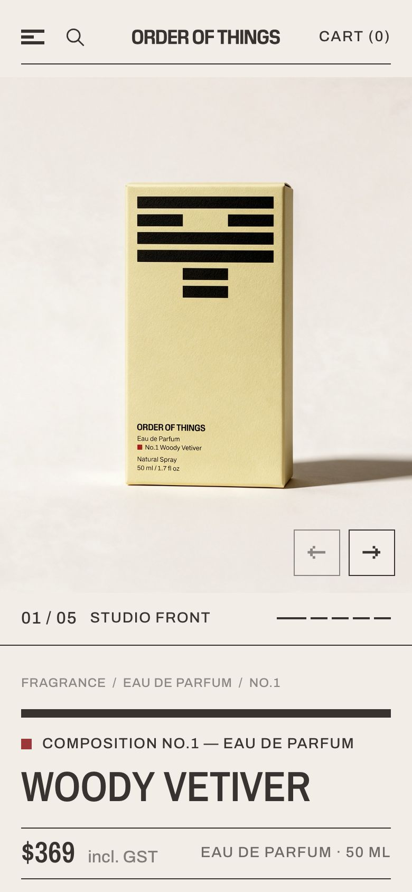
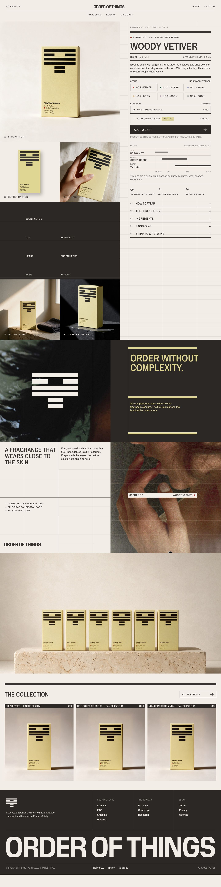
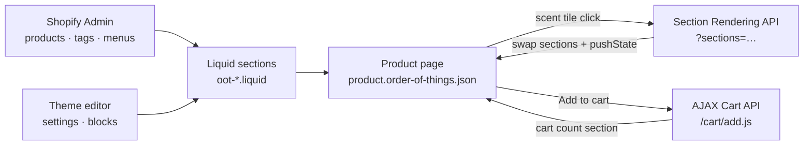

<div align="center">

# Order of Things: Liquid Product Page

**The Order of Things product page built in Shopify Liquid, as a fully editable custom template inside the Horizon theme.**


<br />



</div>

<br />

## Overview

This is the same Figma product page as the [headless Next.js version](https://github.com/ChrisLoui/order-of-things-headless), rebuilt as a native Shopify theme. It runs inside a duplicate of Horizon without changing any of Horizon's own files. **Everything I built is in the `oot-*` files**, and the page uses its own layout, so the rest of the store is unaffected.

Merchants can edit every section, setting and block in the theme editor. Product data such as title, price, scent notes and availability comes from the product in the Shopify admin.

<p align="center">
  
  <br />
  <sub>Mobile · 390px</sub>
</p>

<details>
<summary><b>View the full page</b></summary>
<br />

</details>

## Features

| | |
|---|---|
| 🧴 **Scent switching without a reload** | The scent tiles are real links. With JavaScript, `oot.js` swaps the product sections in place through the **Section Rendering API** and updates the URL with `history.pushState`. The other scents are prefetched when the page is idle, so a switch takes about 15 ms. |
| 🛒 **AJAX cart** | `` posts to `/cart/add.js`, and the header cart count is refreshed through the Section Rendering API in the same request. Without JavaScript it's a normal form post. |
| 🔁 **Subscribe & save** | Reads `product.selling_plan_groups` and submits a real `selling_plan` when a subscription app provides one. Until then the design is shown with the discount from a section setting. |
| 📌 **Sticky buy bar** | Slides up when the main *Add to cart* button scrolls under the header (IntersectionObserver offset by the measured header height), and reuses the panel's form. |
| 📖 **Product story** | Scent notes chart, assurances, a details accordion (one row open at a time, animated in every browser), manifesto, brand story, six cartons and the rest of the collection. |
| ✏️ **Merchant editable** | Every section has a ``. Photos, assurances, accordion rows and footer columns are blocks that can be added, removed and reordered. The menus come from **Content → Menus**. |
| 📱 **Responsive** | Desktop (1440px) and mobile (390px) built to the design, including a swipeable mobile carousel. |
| ♿ **Accessible** | Landmarks and a skip link, `aria-current` on the selected scent, focus kept after a switch, native `<details>`, and reduced-motion support. |

## How it works



**Data conventions.** The page reads the same product tags as the headless version, parsed once in `snippets/oot-composition.liquid`:

| Tag | Meaning |
|---|---|
| `composition-1` … `composition-6` | Composition number: sort order, swatch color, labels |
| `coming-soon` | Unreleased: shown as *Soon* and not purchasable |
| `top:Bergamot` · `heart:Green Herbs` · `base:Vetiver` | Scent notes for the chart and the notes panel |

Each composition's "The composition" text can come from the product metafield `custom.composition_intro`, with the section setting as the fallback.

## What's in the theme

```
layout/oot.liquid                      Own page shell: fonts, oot.css, oot.js, header and footer groups
templates/product.order-of-things.json The product template (assign it to the products)
sections/
  oot-header.liquid  + oot-header-group.json
  oot-product-hero.liquid              Gallery, carousel, buy panel, scent picker, purchase, accordion
  oot-sticky-bar.liquid
  oot-manifesto.liquid · oot-brand-story.liquid · oot-six-cartons.liquid · oot-collection.liquid
  oot-footer.liquid  + oot-footer-group.json
snippets/
  oot-composition.liquid               Tag conventions → number, status, notes (one parser for every section)
  oot-composition-order.liquid         Products in composition order
  oot-purchase-form.liquid             Product form, purchase options, subscribe & save
  oot-carton · oot-notes-chart · oot-price · oot-swatch · oot-rule · oot-icon · oot-image · …
assets/
  oot.css                              Design tokens and shared styles
  oot.js                               Custom elements: carousel, accordion, purchase, sticky bar, scent switching
locales/en.default.json                Adds an "oot" block; nothing else changed
```

Everything else is the Horizon theme, unchanged.

## Getting started

Requires the [Shopify CLI](https://shopify.dev/docs/api/shopify-cli) and a store with the products imported (see [`products.csv`](https://github.com/ChrisLoui/order-of-things-headless/blob/main/shopify-import/products.csv) in the headless repo).

```bash
git clone https://github.com/ChrisLoui/order-of-things-liquid.git
cd order-of-things-liquid
shopify theme dev --store your-store.myshopify.com
# open /products/<handle>?view=order-of-things
```

To use it for real, push it to an unpublished theme (`shopify theme push --unpublished`), then set **Theme template → order-of-things** on each product.

> [!NOTE]
> The page has its own layout, so Horizon's CSS and JavaScript never load on it, and the `oot-*` files never load anywhere else. To remove the page, delete the `oot-*` files and the template.

## Notes

- **Fonts:** Pilat and Pilat Narrow are commercial, so Archivo and Archivo Narrow stand in. They're set in one snippet (`oot-fonts`).
- **Currency:** prices use `| money`, so the page shows A$ once the store currency is AUD.
- **Quality:** `shopify theme check` reports 0 offenses for every `oot-*` file.

Decisions, challenges and the time log are in [`NOTES.txt`](NOTES.txt).

<div align="center">
<br />
<sub>Design: Order of Things · Built by Chris Loui Cañete</sub>
</div>
